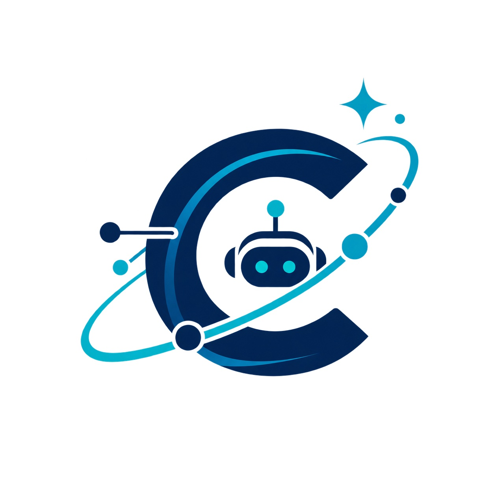

<p align="center">
  
</p>

# CetiRun

CetiRun is an open-source managed runtime for hosting AI agents and AI applications.

It provides isolated, persistent instances on a shared AKS cluster, with authenticated access and managed lifecycle operations. The current runtime supports [OpenClaw](https://github.com/openclaw/openclaw) and [Hermes](https://github.com/NousResearch/hermes-agent) agents, with a Kubernetes operator and self-service portal for deployment and management.

## Architecture

CetiRun deploys on an AKS cluster. Each team member gets a dedicated namespace (`cetirun-<alias>`) containing an OpenClaw or Hermes StatefulSet.

```
+-----------------------------------------------------------------------------------+
|                              AKS Cluster                                          |
|                                                                                   |
|  aks-istio-ingress     Istio Gateway + AuthorizationPolicy + EnvoyFilters         |
|                        Host-based routing: <alias>.<your-domain>                  |
|                                                                                   |
|  cetirun-istio NS      OAuth2 Proxy (Azure AD authentication)                     |
|                                                                                   |
|  cetirun-<alias> NS    OpenClaw Pod (StatefulSet)                                 |
|                        ├── OpenClaw Gateway :18789                                 |
|                        └── PVC: /home/vibe (Azure Blob NFS)                       |
|                                                                                   |
|  cetirun-system NS     CetiRun Operator + Portal                                  |
+-----------------------------------------------------------------------------------+
         |                                    |
         v                                    v
  GitHub Copilot API                  Knowledge RAG Engine
```

### Components

| Component | Location | Purpose |
| --- | --- | --- |
| **Agent Runtime** | `app/cetirun-chart/` | OpenClaw or Hermes instance (StatefulSet) with persistent storage, Chrome, and pre-installed CLI tools |
| **CetiRun Operator** | `app/cetirun-operator/` | Manages instance lifecycle via `Agent` CRD — provisions namespaces, Helm releases, and ingress |
| **CetiRun Portal** | `app/cetirun-portal/` | Admin dashboard (React + Go) for creating, managing, and monitoring instances |
| **AdminClaw** | `app/adminclaw/` | Admin deployment tools and platform operations skill |
| **Istio Auth** | `infra/istio/` | OAuth2 Proxy + Istio Gateway + EnvoyFilters for Azure AD authentication and per-engineer authorization |
| **Infrastructure** | `infra/` | Bicep templates for AKS cluster and Azure Blob NFS storage |

## Getting Started

### Prerequisites

- An AKS cluster with:
  - [Istio addon](https://learn.microsoft.com/en-us/azure/aks/istio-about) enabled with external ingress gateway
  - [Blob CSI driver](https://learn.microsoft.com/en-us/azure/aks/azure-blob-csi) enabled
  - OIDC issuer enabled (for workload identity)
- Azure Blob Storage account (Premium, NFS v3)
- Azure Container Registry (ACR)
- Entra ID (Azure AD) app registration for OAuth2 authentication
- Wildcard DNS record pointing to the Istio ingress gateway
- TLS certificate for your domain (stored in Azure Key Vault)

### Deploy Infrastructure

```bash
# Provision AKS cluster
RESOURCE_GROUP=my-rg LOCATION=westeurope \
  ./infra/cluster/deploy.sh

# Provision blob storage for skills and persistent volumes
RESOURCE_GROUP=my-rg AKS_CLUSTER_NAME=my-cluster \
  ./infra/storage/deploy.sh

# Deploy Istio auth (OAuth2 Proxy + Gateway)
CLIENT_ID=<app-id> TENANT_ID=<tenant-id> ALLOWED_GROUPS=<group-oids> \
DOMAIN=example.com KEY_VAULT_NAME=my-kv RESOURCE_GROUP=my-rg \
AKS_CLUSTER_NAME=my-cluster \
  ./infra/istio/deploy.sh
```

### Deploy Components

```bash
# Deploy operator
cd app/cetirun-operator
REGISTRY=cetirun.azurecr.io CHART_VERSION=0.1.0 DOMAIN=example.com \
  deploy/deploy.sh

# Deploy portal
cd app/cetirun-portal
REGISTRY=cetirun.azurecr.io CHART_VERSION=0.1.0 \
  deploy/deploy.sh
```

### Create an Agent

Once the operator is running, create long-lived agents via the CRD. The
`cetirun.microsoft.com/v1beta1` API exposes `Agent` and `Team`; see the
[API contract and existing-cluster limitations](app/cetirun-operator/README.md#api-contract)
before using it with an older installation.

```yaml
apiVersion: cetirun.microsoft.com/v1beta1
kind: Agent
metadata:
  name: alice
spec:
  gatewayTokenSecretRef: "gateway-token"
  user:
    alias: alice
    displayName: "Alice"
    team: platform
```

Or use the Portal UI at `https://<your-domain>/`.

## Skills

Skills are the primary extensibility mechanism — directories containing a `SKILL.md` file with YAML frontmatter and natural language instructions.

### Skill Loading Precedence

1. **Workspace skills** — per-engineer custom skills on the PVC (private)
2. **Shared skills** — mounted from Azure Blob NFS at `~/.aks/skills/` (read-only)

You can populate shared skills by uploading skill directories to the Azure Blob Storage container configured in the OpenClaw Helm chart values.

## Security

| Layer | Description |
| --- | --- |
| **Azure AD (Entra ID)** | Group-based access control |
| **Per-engineer authorization** | OAuth2 Proxy validates alias matches hostname — no cross-instance access |
| **Credential isolation** | Credentials managed via `openclaw models auth`, isolated per instance |
| **Network policies** | Default deny-all; allow only Istio ingress, DNS, and external HTTPS (RFC 1918 blocked) |
| **Namespace isolation** | Each engineer gets a fully isolated namespace |

## Contributing

Contributions are welcome. For changes more complex than typos, please submit an issue first to discuss the approach.

## License

[MIT](LICENSE)

## Trademarks

This project may contain trademarks or logos for projects, products, or services. Authorized use of Microsoft trademarks or logos is subject to and must follow [Microsoft's Trademark & Brand Guidelines](https://www.microsoft.com/en-us/legal/intellectualproperty/trademarks/usage/general). Use of Microsoft trademarks or logos in modified versions of this project must not cause confusion or imply Microsoft sponsorship. Any use of third-party trademarks or logos are subject to those third-party's policies.
