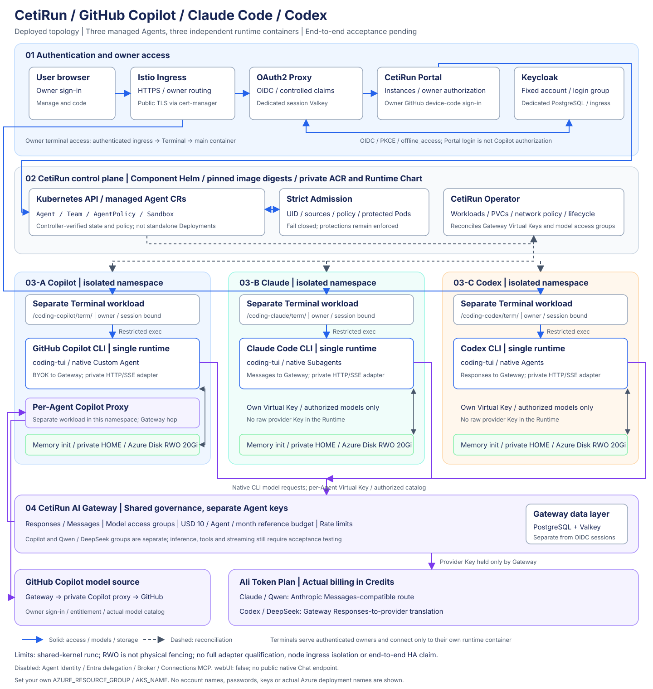

# CetiRun coding agent runtimes

Run GitHub Copilot CLI, Claude Code, and Codex CLI as three independent Custom
Agents in CetiRun. Each Agent has its own native runtime container, an
authenticated terminal, a persistent HOME, and an AI Gateway Virtual Key.

The application in [`app/`](app/README.md) runs the real CLIs. It does not
simulate coding responses. For an offline demonstration of the Custom Chat
interface with fixed synthetic results, refer to
[`examples/coding-runtime/`](examples/coding-runtime/README.md). For an
introduction to CetiRun, refer to the [root README](../../README.md).

## What this example contains

This example uses the Custom runtime contract. It does not add a built-in
harness or a CRD type, and each image runs one CLI. The example hosts the
CLIs, not the GitHub cloud agent service, Claude hosted sessions, or Codex Web.

| Agent | Native runtime | Role configuration | Model route |
| --- | --- | --- | --- |
| `coding-copilot` | GitHub Copilot CLI | `app/profiles/.github/agents/` | GitHub Copilot through the private per-Agent Copilot proxy |
| `coding-claude` | Claude Code | `app/profiles/.claude/agents/` | A Gateway model through an Anthropic Messages-compatible route |
| `coding-codex` | Codex CLI | `app/profiles/.codex/agents/` | A Gateway model through the Responses API, with translation to the provider protocol |

The Agent names are examples. The three CLIs use different native agent
formats and delegation mechanisms. They do not share a prompt-runner
abstraction. Check each model against the authorized catalog of the Agent.

`Ready`, a successful `/healthz`, or an authorized catalog does **not** show
that a provider, model, and CLI combination can complete a coding task.

## Architecture



[Open the SVG](docs/architecture.svg). The diagram shows one example topology.
Your identity provider, model providers, and storage can be different. Each
terminal uses restricted Kubernetes exec into **the main container of its own
Agent**. The private Copilot proxy is a separate workload, not a second coding
runtime in the main container.

| Layer | Responsibility | Boundary |
| --- | --- | --- |
| Authentication | Istio, cert-manager, OAuth2 Proxy, and the OIDC issuer supply HTTPS, OIDC with PKCE, and controlled owner claims | Portal sign-in is not Copilot model authorization or a GitHub repository connection |
| Control plane | The Portal manages instances, admission validates resources, and the Operator reconciles workloads, policies, storage, and model access | These are managed Agent resources, not standalone Deployments |
| Execution | One native runtime in each main container, a separate terminal workload, and Memory init for each Agent | The runtime user is `1024:1024`. Agents do not share a writable HOME or checkout. |
| Storage | A private ReadWriteOnce HOME for each Agent, with the workspace at `$HOME/workspace` | RWO is not physical single-writer fencing. Sessions do not move between runtimes. |
| Model access | The AI Gateway authorizes each Virtual Key, its model groups, budget, and rate limits | The runtime containers get no raw provider keys |
| Delivery | Your registry stores the pinned images and the Runtime Helm Chart | Deployment inputs and credentials stay outside Git |

**Interactive request path:** owner sign-in, terminal and session
authorization, restricted exec, `coding-tui`, the native CLI, the AI Gateway,
the authorized model source, workspace edits, and test runs. The Portal
manages resources. It does not replace the native inference loop.

`server.py` also has private HTTP and SSE endpoints: `/healthz`, `/v1/models`,
and `/v1/chat/completions`. The application has no public authentication layer
of its own. Keep **`webUI: false`**. Do not expose its port 8080 through an
anonymous Ingress or LoadBalancer. For the Gateway, skills, and Memory
integration and the HTTP limits, refer to the
[application README](app/README.md).

## Requirements

| Area | Requirement |
| --- | --- |
| Workstation | macOS or Linux with Bash, Git, and Make. Python 3.11 or later for the checks. |
| Image builds | Docker with Buildx. The images are `linux/amd64` only. An ARM64 workstation needs a builder that can target amd64. |
| Platform | An installed CetiRun platform with the AI Gateway and Custom runtime support. Refer to [Install CetiRun](../../site/content/en/docs/getting-started/platform.md). |
| Nodes | Linux amd64 nodes that can pull from your registry |
| Storage | A StorageClass for the private HOME of each Agent |
| Model access | For the Copilot Agent, a GitHub account with Copilot access to the selected model. For the other two Agents, Gateway models that the Agent policy allows. |

The runtime images contain Python, Git, and the HOME initialization tools.
Each image installs and runs one pinned native CLI. The images also contain
the CLIs that the CetiRun base image installs, for example Codex and Claude
Code. Browser users do not need `az`, Docker, Helm, or Kubernetes credentials
inside the runtime container.

## Build and test locally

Run these commands from the repository root:

```bash
make -C examples/coding-agents/app test check
make -C examples/coding-agents/app build
```

The checks need no network access. The build downloads the pinned base image
and the official native artifacts, and it verifies their SHA-256 hashes. It
uses no remote installers and embeds no credentials. The build produces
`cetirun-copilot:local`, `cetirun-claude:local`, and `cetirun-codex:local`.
These commands do not deploy anything or call a paid model. For cached
artifacts and the adapter limits, refer to the [application README](app/README.md).

At startup, the runtime needs the `OPENAI_BASE_URL` and `OPENAI_API_KEY` that
the platform injects. `OPENAI_API_KEY` must be the **Agent Virtual Key**, not a
raw provider key. If this configuration is missing, startup fails. The native
role templates initialize the workspace and keep the files that the user
maintains.

## Deploy the three Agents

> **Warning:** These steps publish images and change resources in a cluster.
> Get explicit authorization for the target registry and cluster first.

1. Tag the three images for your registry, push them, and record the digest of
   each image. For example:

   ```bash
   docker tag cetirun-claude:local registry.example.com/team/cetirun-claude:<tag>
   docker push registry.example.com/team/cetirun-claude:<tag>
   ```

2. Custom provisioning is enabled by default. Ask an administrator to approve
   the three digests in the platform values:

   ```yaml
   cetirun-operator:
     customRuntime:
       enabled: true
       approvedImages:
         - registry.example.com/team/cetirun-copilot@sha256:<approved-digest>
         - registry.example.com/team/cetirun-claude@sha256:<approved-digest>
         - registry.example.com/team/cetirun-codex@sha256:<approved-digest>
   ```

3. Create one Custom Agent for each image. Replace the Team, the owner, the
   digest, and the chart version. For a Sandbox Agent, also add a
   `sandboxRef` that the Team allows. This example is for Claude Code:

   ```yaml
   apiVersion: cetirun.microsoft.com/v1alpha1
   kind: Agent
   metadata:
     name: coding-claude
   spec:
     team: "<existing-team>"
     user:
       alias: "<your-user-alias>"
       displayName: "<your-display-name>"
     modelAccess:
       sharedModels: true
       githubCopilot: false
     agent:
       type: custom
       image: "registry.example.com/team/cetirun-claude@sha256:<approved-digest>"
       username: vibe
       port: 8080
       webUI: false
     helm:
       version: "<compatible-chart-version>"
       values:
         ttyd:
           enabled: true
         desktop:
           enabled: false
   ```

   For `coding-copilot`, set `githubCopilot: true` to use the Copilot proxy.
   For `coding-codex`, use the Codex image.

The platform creates the namespace, the HOME PVC, and the Virtual Key of each
Agent. Do not create them in advance. For the Custom image contract, refer to
[Custom runtime](../../site/content/en/docs/reference/agent-harness.md#custom-runtime).

## Use the Agents

### 1. Sign in

Open your Portal at `https://<your-portal-host>` and sign in as the owner. Then
open the authenticated terminal of each Agent:

| Agent | URL |
| --- | --- |
| Copilot | `https://<your-portal-host>/coding-copilot/term/` |
| Claude Code | `https://<your-portal-host>/coding-claude/term/` |
| Codex | `https://<your-portal-host>/coding-codex/term/` |

For Copilot, first complete the **GitHub Copilot sign-in** of the owner in the
Portal. The account must have access to the model that you select. This
authorization of the model source does not give repository access. It does not
replace a separate product sign-in of the CLI. Claude Code and Codex use their
Gateway Virtual Keys. Do not paste provider keys into the terminal, and do not
change to personal provider endpoints.

### 2. Check the authorized catalog

Run this command **in the browser terminal of the Agent**, not on your
workstation. It lists the authorized model IDs. It makes no inference call and
prints no keys:

```bash
python3 -c 'import sys; sys.path.insert(0,"/opt/cetirun-coding"); from native import Gateway; print("\n".join(Gateway.from_environment().models()))'
```

Use a model ID that the catalog returned, not a display name or an assumed
alias:

```bash
MODEL='<authorized-model-id>'
python3 /opt/cetirun-coding/server.py doctor --model "$MODEL"
coding-tui --model "$MODEL"
```

`doctor` must report `"requestedModelAuthorized": true`. It does not test
inference. If the catalog lookup or the authorization fails, stop. Do not
select a different model or bypass the Gateway.

### 3. Do a coding smoke test

Give each native CLI this task separately:

> Work only in a new `smoke-test` directory under the current workspace.
> Create `calculator.py` with `add(a, b)`, and `test_calculator.py` using
> Python unittest for integers, negative values, and decimals. Actually run
> `python3 -m unittest discover -s smoke-test -p 'test_*.py' -v`.
> Report changed files, test output, and the exit code. Do not install
> dependencies, read credentials, commit, or push.

Make sure that the CLI created the files and that the tests passed. A proposed
code listing is not sufficient. After you exit the CLI, run the tests yourself:

```bash
cd "$HOME/workspace"
python3 -m unittest discover -s smoke-test -p 'test_*.py' -v
```

Connect to the terminal again, and make sure that the files are still there.
Test cancellation and the Portal suspend and resume operations separately. A
reconnection does not show that a restart keeps the files. The deletion of an
Agent or a PVC is not a restart procedure. Real model tasks use the allowance
of the provider.

## Important considerations

### Credentials

Keep provider credentials in the Gateway Secrets. A credential rotation needs
an approved rollout and a verification. Never publish private keys, bootstrap credentials,
kubeconfigs, or deployment records that contain secrets.

### Model compatibility and cost

Claude Code with a third-party model through Anthropic Messages is a
compatibility route, not a claim of official Claude model support. Codex needs
a Gateway route that translates Responses requests to the protocol of the
provider. Test tools, streaming, errors, and cancellation for each combination
of CLI, provider, and model.

Gateway budgets and spend are management values. They are not provider
invoices or provider quotas. Make sure that the terms of the provider allow
the Gateway forwarding and the intended use before real use. Do not run
unattended paid API tests. Cancellation does not undo tool side effects or
charges.

### Isolation

The isolation depends on the Sandbox that each Agent uses. Ordinary runc
containers share the node kernel. They do not give Kata VM isolation. For the
HOME and checkout rules, refer to the
[access and isolation notes](app/README.md#access-and-isolation).

## Project layout

| Path | Contents |
| --- | --- |
| [`app/`](app/README.md) | Runtime adapter, build instructions, HTTP and SSE behavior, and application limits |
| [`app/profiles/`](app/profiles/) | Native Copilot, Claude Code, and Codex role templates |
| [`docs/architecture.svg`](docs/architecture.svg) | Architecture diagram |
| [`examples/coding-runtime/`](examples/coding-runtime/README.md) | Offline interface demonstration, labeled `OFFLINE MOCK`. It is not the coding application. |
| [`../../app/`](../../app/) | Platform source in the same repository |
