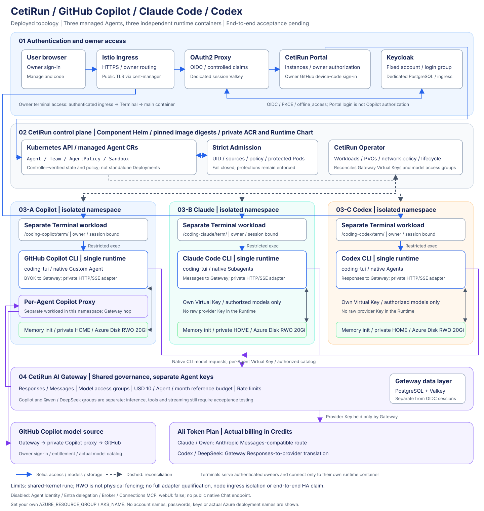

# CetiRun Coding Agent Runtimes

[English](README.md) | **简体中文**

在 Azure Kubernetes Service（AKS）上，将 **GitHub Copilot CLI、Claude Code 和
Codex CLI 作为三个独立、受 CetiRun 管理的 Agent 运行**。每个 Agent 都有自己的
原生 Runtime 容器、经过认证的终端、持久 HOME 和 AI Gateway Virtual Key。

[`app/`](app/README.md) 中的应用执行真实原生工具，不模拟编码结果。
基础设施就绪与模型端到端验收分别记录，不能混为一谈。

## CetiRun 是什么？

CetiRun 是基于 Kubernetes 的托管运行平台，用于在 AKS 上持久运行 AI Agent 和
AI 应用。Operator 负责调谐 Agent 资源和生命周期，自助 Portal 提供经过认证的
访问与管理。平台整合了执行策略、持久存储、终端访问和受治理的模型路由。

CetiRun 包含 OpenClaw 和 Hermes Harness。本示例使用现有 **Custom Harness** 契约，
接入三种额外的原生 Coding Runtime，不新增 CRD 类型，也不将三个 CLI 混装进同一
镜像。托管对象是 CLI，而不是 GitHub cloud agent 服务、Claude 托管会话或 Codex Web。

本示例直接维护于 CetiRun 仓库的 [`examples/coding-agents/`](./) 目录，
不再是独立仓库或 Git submodule。平台源码使用同仓库的
[`../../app/`](../../app/)，平台检查请参阅[开发指南](../../DEVELOPMENT.md)，
无需额外克隆参考源码。

| 托管 Agent | 原生 Runtime | 项目角色配置 | 已配置的模型路由 |
| --- | --- | --- | --- |
| `coding-copilot` | GitHub Copilot CLI | `app/profiles/.github/agents/` | 经过每 Agent 私有代理访问 GitHub Copilot |
| `coding-claude` | Claude Code | `app/profiles/.claude/agents/` | 经过 Anthropic Messages 兼容路径访问 Qwen |
| `coding-codex` | Codex CLI | `app/profiles/.codex/agents/` | 经过 Gateway Responses 转换路径访问 DeepSeek |

三者采用不同的原生 Agent 格式和委派机制，不是一个通用 prompt runner。
模型是否可用，必须以该 Agent 实际获准的 catalog 为准。

## 部署状态

**历史部署快照日期：2026-11-09。**以下结果记录于示例迁入本仓库之前，
不代表对全新 checkout 或其他环境的验证。当日已重新验证 Runtime 更新、控制面健康、
Agent/存储身份、终端登录跳转和严格 admission；其他条目汇总此前部署证据：

| 范围 | 已记录结果 |
| --- | --- |
| 控制面 | Operator、Portal、AI Gateway 和严格 admission 各为 2/2 Ready |
| 托管 Agent | 三个实例均为 `Ready`，且 `PolicyApplied=True`；独立终端工作负载均就绪 |
| Runtime 更新 | 三个重建镜像已发布到私有 ACR 并逐一上线；已验证实际运行的不可变 digest，原 HOME PVC 身份和 PV 绑定均保留 |
| 持久化 | 每 Agent 独享 20Gi Azure Disk RWO HOME；已测试跨节点重新挂载 |
| 认证 | 已验证 HTTPS OIDC discovery、PKCE、受控身份声明、登录组和 owner 的 `offline_access` 权限；未登录终端请求返回 302 |
| 原生执行 | 已注册限定范围的 `native-single-start`；完成 CPU/内存、只读根文件系统和两节点 TCP/UDP egress 范围测试 |
| 模型治理 | 已读回验证每 Agent 独立 Virtual Key，管理参考预算为 USD 10/月 |
| 端到端验收 | 完整浏览器会话、Copilot entitlement、真实编码/模型调用、工具/流式/取消及生命周期验收，尚未记录为完成 |

`Ready`、`/healthz` 成功或 catalog 授权通过，**不等于**某个厂商/模型/CLI 组合
能够完成真实编码任务。

## 项目架构



[打开 SVG 原图](docs/architecture.svg)。SVG 内所有文字保持英文。图为自包含文件，
不依赖 Mermaid、外部图片或脚本。

```text
Browser / owner
    |
    v
Istio Ingress <-> OAuth2 Proxy + session Valkey <-> Keycloak + PostgreSQL
    |
    +-- Portal --> Kubernetes API: Agent / Team / AgentPolicy / Sandbox
    |                         |                        |
    |                   Strict admission           Operator
    |                                                  :
    +-- Owner-bound terminal sessions                  : reconcile
                 |                                     :
        +--------+-------------------+-----------------+
        |                            |                 |
  Copilot namespace          Claude namespace    Codex namespace
  Terminal -> Copilot CLI    Terminal -> Claude   Terminal -> Codex
  Memory init               Memory init          Memory init
  Private HOME PVC          Private HOME PVC     Private HOME PVC
        |                            |                 |
        +----------------------------+-----------------+
                                     |
                       AI Gateway / per-Agent Virtual Key
                       Model groups / budget / rate limits
                       Gateway PostgreSQL + Gateway Valkey
                              |                 |
                   Private Copilot proxy    Ali Token Plan
                   in Copilot namespace     Qwen / DeepSeek
                              |
                     GitHub Copilot models
```

文本图中的 `:` 表示控制面调谐，不是推理请求。每个终端通过受限 Kubernetes exec
进入**自己的 Agent 主容器**。私有 Copilot proxy 是独立工作负载，不是主容器中
额外安装的 Coding Runtime。

| 层 | 职责 | 边界 |
| --- | --- | --- |
| 认证 | Istio、cert-manager、OAuth2 Proxy 和 Keycloak 提供 HTTPS、OIDC/PKCE 与受控 owner 声明 | Portal 登录不等于 Copilot 模型授权或 GitHub 仓库连接 |
| 控制面 | Portal 管理实例；admission 校验资源；Operator 调谐工作负载、策略、存储和模型访问 | 使用正式 managed Agent CR，不以独立 Deployment 冒充 Agent |
| 执行 | 每个主容器只有一个原生 Runtime；每 Agent 另有独立终端工作负载和 Memory init | 非 root 用户 `1024:1024`；不同 Agent 不共享可写 HOME 或 checkout |
| 存储 | 私有 Azure Disk RWO HOME；workspace 位于 `$HOME/workspace` | RWO 不代表物理单写者 fencing；会话不能跨 Runtime 迁移 |
| 模型访问 | AI Gateway 检查独立 Virtual Key、模型组、预算和速率限制 | 厂商原始 Key 不注入 Runtime 容器 |
| 交付 | 私有 ACR 保存固定版本/digest 的 Runtime、平台镜像和 Runtime Helm Chart | 本机部署输入和凭据不进入 Git |

**一次交互的路径：**owner 登录、终端/session 授权、受限 exec、`coding-tui`、
原生 CLI、AI Gateway、获准模型源、workspace 文件修改和测试执行。Portal 负责
资源管理，不替代原生推理循环。

`server.py` 还实现了私有 HTTP/SSE 接口：`/healthz`、`/v1/models` 和
`/v1/chat/completions`。应用没有独立的公网认证层。必须保持 **`webUI: false`**，
不能通过匿名 Ingress 或 LoadBalancer 暴露其 8080 端口。

HTTP 与终端共用 Gateway 路由和 `$HOME/.agents` 平台主指令加载逻辑，并接入各
CLI 的原生技能发现机制。Copilot 使用适配器专属的 provider registry，不修改
用户原配置；仅在平台提供 Memory 时接入，并保留 `off` / `no-capture` 限制。
HTTP 最多接受 1 MiB、100 条消息、每条用户输入 64 KiB，任务期限 600 秒；
SSE 每帧最多 64 KiB，中文与 emoji 安全分段。不偷偷裁剪历史，终端不受 HTTP
任务期限影响。详见[适配器说明与离线检查](app/README.md)。本轮修订已发布并部署
到全部三个托管 Agent；实际构建镜像通过了 6 组离线原生 CLI 协议回归，
真实 owner/模型验收仍未完成。

## 运行环境

开发机负责开发和管理工具；Coding CLI 在 AKS 的 Linux 容器内运行。
通过浏览器终端使用时，无需在开发机上安装全部三个 CLI。

### 开发机工具

以下版本于 **2026-11-09** 在本机检查，是环境快照，不是所有环境通用的最低版本，
也不是要求升级共享机器的指令。

| 工具 | 要求与用途 | 本机记录版本 |
| --- | --- | --- |
| 操作系统 / Shell | macOS 或 Linux，具备兼容 Bash 的工具环境；记录中的开发机为 macOS ARM64，交叉构建 Linux amd64 镜像 | macOS / ARM64 |
| Python | 应用检查需要 Python 3.11+；本机部署辅助脚本还需要 PyYAML | 3.14.7 |
| Azure CLI（`az`） | Azure 管理、获准订阅访问、AKS/ACR 操作和镜像仓库认证所需 | 2.92.0 |
| Azure Developer CLI（`azd`） | 当前组件 Helm 路线可选；只有引入单独审查过的 `azd` 工作流时才需要 | 1.37.2 |
| Docker | 本地构建/测试镜像所需；需要正在运行的 Linux 容器引擎 | Docker CLI 29.9.2 |
| Docker Buildx | 构建 `linux/amd64` 镜像所需；ARM64 开发机需要具备 amd64 目标构建能力的 builder | 0.38.1 |
| Kubernetes CLI（`kubectl`） | 管理员操作所需；客户端/服务端版本差异必须符合支持范围，优先使用与服务端相同的 minor 版本 | 客户端 1.36.1；已记录服务端 1.37.1 |
| Helm | 组件和 Runtime Chart 所需；已审查的 Helm 4 辅助脚本使用 `--server-side false`，保留 AKS 托管字段归属 | 4.3.1 |
| Git、兼容 GNU Make 的 `make`、OpenSSL 和 curl | 源码访问、本地检查/构建、证书验证和诊断 | 工具可用；此处不固定版本 |
| Go / Node.js | 仅重建上游平台服务/前端时需要，遵循固定源码中的 manifest | 不是原生 Python 应用的前置依赖 |

`az` 与 `azd` 是不同工具。**安装 Azure Developer CLI，不等于本项目应通过
`azd up` 部署。**当前安装仍由审查过的组件 Helm 输入和辅助脚本管理。

构建或管理平台前，可检查工具环境：

```bash
python3 --version
python3 -c 'import yaml; print("PyYAML", yaml.__version__)'
az version
azd version
docker --version
docker buildx version
kubectl version --client
helm version --short
```

PyYAML 检查适用于部署辅助脚本；当前路线中的 `azd version` 检查为可选。
版本检查不能证明 Docker 引擎正在运行、Azure 认证有效或集群已获得资格。
请使用获准的订阅权限及专用 kubeconfig/context；部署辅助脚本还会在写入前核验
API 地址和 `kube-system` UID。

### AKS 与容器要求

| 范围 | 所需环境 / 已记录基线 |
| --- | --- |
| Kubernetes | 已验证部署目标为 AKS **1.37.1**；固定上游源码的完整部署路线要求 1.37+。其他集群仍须核验 API 可用性和 Sandbox 资格 |
| 节点 / 镜像 | Linux amd64 节点与 `linux/amd64` 镜像；当前 Runtime 为 `runc`，不是 Windows 容器，也不能推定为 Kata VM 隔离 |
| 网络 | 托管 Istio、公网 HTTPS 入口、实际生效的 Cilium/NetworkPolicy、可用 DNS，以及获准的 API/模型 egress |
| Admission | 所需 admission API、严格 admission 服务、已验证 TLS，以及管理审查过的集群级资源的权限 |
| 存储 | Azure Disk CSI 和已审查的 StorageClass；每 Agent 独享 20Gi RWO HOME |
| 镜像仓库 | 节点能从私有 ACR 拉取镜像，Operator 能只读访问 OCI Runtime Chart；产物须固定且匹配源码 |
| 身份 / TLS | 正式 Keycloak OIDC、OAuth2 Proxy、允许的登录组、精确 callback、PKCE、cert-manager，以及有效的公网/内部证书 |
| 容量 | 为控制面、三个 Agent、终端 helper、数据库和缓存准备 CPU/内存、磁盘配额及 rollout 余量 |
| 模型访问 | 获准的 Copilot 账号或符合许可的 Ali Token Plan；厂商凭据仅在 Gateway，Agent 使用独立 Virtual Key |

Runtime 镜像内置 Python、Git、所需 HOME 初始化工具，并且每个镜像只包含一个
固定版本的原生 CLI。浏览器用户无需在 Runtime 容器内安装 `az`、`azd`、
Docker 或 Helm，也不需要将 Kubernetes 凭据放入容器。

## 使用已部署的 Agent

### 1. 登录

打开配置的 Portal：`https://<your-portal-host>`。本机部署的初始凭据仅保存在
`.deployment/oidc-owner-login.json` 中，权限为 `0600`。请在本机打开文件查看，
首次登录后修改临时密码，不要分享或提交该文件。密码修改后，初始密码可能不再有效。

打开对应的受保护终端：

| Agent | URL |
| --- | --- |
| Copilot | `https://<your-portal-host>/coding-copilot/term/` |
| Claude Code | `https://<your-portal-host>/coding-claude/term/` |
| Codex | `https://<your-portal-host>/coding-codex/term/` |

Copilot 必须先在 **Portal 中完成本人 GitHub Copilot 登录授权**，且账号确实提供
所需模型。该模型源授权不授予仓库访问权限，也不替代 CLI 产品可能单独要求的登录。
Claude 和 Codex 使用 Gateway Virtual Key，不要在终端粘贴厂商 Key，也不要切换到
个人厂商直连接口。

### 2. 检查获准的 catalog

以下命令在 **Agent 的浏览器终端内**执行，不是在本机终端执行。
它只列出获准的模型 ID，不进行推理或打印 Key：

```bash
python3 -c 'import sys; sys.path.insert(0,"/opt/cetirun-coding"); from native import Gateway; print("\n".join(Gateway.from_environment().models()))'
```

使用该 catalog 实际返回的对应模型 ID，而不是显示名称或推测的别名：

```bash
MODEL='<authorized-model-id>'
python3 /opt/cetirun-coding/server.py doctor --model "$MODEL"
coding-tui --model "$MODEL"
```

`doctor` 应返回 `"requestedModelAuthorized": true`；这不是推理测试。
如果 catalog 读取或授权失败，请停止，不要静默替换模型或绕过 Gateway。

### 3. 完成真实编码冒烟测试

分别向每个原生 CLI 输入以下任务：

> 仅在当前 workspace 下的新建 `smoke-test` 目录内工作。
> 创建 `calculator.py`，实现 `add(a, b)`；创建 `test_calculator.py`，
> 使用 Python unittest 测试整数、负数和小数。实际执行
> `python3 -m unittest discover -s smoke-test -p 'test_*.py' -v`。
> 报告修改的文件、测试输出和退出码。不要安装依赖、读取凭据、提交或推送。

确认文件确实创建、测试实际通过，而不是只接受一份建议代码。
退出 CLI 后，再独立执行：

```bash
cd "$HOME/workspace"
python3 -m unittest discover -s smoke-test -p 'test_*.py' -v
```

重新连接终端，确认文件仍存在；再单独测试取消和获准的 Portal 挂起/恢复操作。
重新连接不等于验证了重启保留，删除 Agent 或 PVC 也不是重启方法。
真实模型任务会消耗对应厂商额度。

## 构建与配置

### 本地开发

检查需要 Python 3.11+；构建镜像需要 Docker 和 Buildx。构建目标是
**Linux amd64**，下载固定版本的官方原生 artifact 并验证 SHA-256，
不执行远程 installer，也不把凭据放入镜像。

从 CetiRun 仓库根目录执行：

```bash
cd examples/coding-agents
make -C app test check
make -C app build
```

构建产物为 `cetirun-copilot:local`、`cetirun-claude:local` 和
`cetirun-codex:local`。这些命令**不会部署 AKS，也不会测试收费模型推理**。
已验证 artifact 缓存用法和适配器限制参见[应用说明](app/README.md)。

真实启动需要平台注入 `OPENAI_BASE_URL` 和 `OPENAI_API_KEY`；后者必须是
**Agent Virtual Key**，而不是厂商原始 Key。配置缺失时拒绝启动。
原生角色模板在 workspace 初始化时生成，不覆盖已有用户维护文件。

### 平台配置

现有部署使用 **组件 Helm + 正式 Keycloak HTTPS OIDC**，而不是依赖 Entra 的
完整部署路线。管理员需要经过审查的平台源码、匹配的 Chart/镜像 digest、
Kubernetes/Helm/Azure 工具，以及安装了 PyYAML 的 Python 环境。

本机配置与证据有意被 Git 忽略：

| 路径 | 用途 |
| --- | --- |
| `.deployment/cetirun.environment.yaml` | 目标集群/context/UID、域名、OIDC、镜像固定值、组件配置、来源和协调绑定 |
| `.deployment/native-team.yaml` | Sandbox、AgentPolicy 和 Team 定义 |
| `.deployment/agents.yaml` | 三个托管 Agent 定义 |
| `.deployment/billing.inputs.yaml` | Credits 约束和明确标注的 USD 管理参考估值 |
| `.deployment/platform-artifacts.json` | 匹配的平台镜像 digest |
| `.deployment/managed-agents-verification.json` | 已记录的 managed Agent 就绪证据 |
| `.deployment/native-platform-registration.json` | 原生拓扑注册及限定能力声明 |

在其他环境中，请填写自己的 `AZURE_RESOURCE_GROUP`、`AKS_NAME`、订阅、
镜像仓库、DNS、kubeconfig/context 和已验证的集群 UID。不要复用其他集群的
来源/协调 UID 或凭据。被忽略的 `.deployment/` **不是可移植的一键安装器**，
也不会出现在全新 checkout 中。本文所有 `.deployment/` 路径均相对于
`examples/coding-agents/`。

新环境请遵循本仓库的[平台部署指南](../../app/cetirun-platform/README.md#deploy-the-platform)。
历史使用的 `.deployment/render_component_values.py` 和
`.deployment/deploy_control_plane.py` 不随本示例分发。生成配置不等于部署。
不要盲目运行平台 `make deploy`、旧 `infra/istio/deploy.sh`、重新 apply 运行中的
Agent 定义，或在已有 Agent 时重新执行原生来源注册。
在线配置修改必须经过获准的协调和生命周期流程。

## 注意事项

### 认证与凭据

保持 HTTPS、PKCE、受控身份声明、登录组和严格 admission 开启。当前路线关闭
Agent Identity 创建/清理、Entra 委派、Broker 和 Connections MCP；
已经创建但未启用的组件，不计入实际请求链路。

如果 Keycloak 报错 `Offline tokens not allowed for the user or client`，检查
client 的 `offline_access` scope 和 owner 对应的 realm role。
`.deployment/verify_oidc.py` 默认只读；只有显式使用 `--repair-offline-access`，
才会通过获准的私有 TLS 管理连接补齐缺失角色，不会重置密码。
应从 Portal 重新发起登录，而不是刷新已经消费过授权码的旧 OAuth 回调页。
不要为了修复而公开管理 API。

厂商凭据保存在 Gateway Secrets 中。本机隐藏输入轮换工具为：

```bash
python3 .deployment/set_model_secret.py
```

请在管理员本机交互式执行。工具会核验目标，不打印 Key、不调用模型，也不会自动
重启 Gateway。轮换后仍需经过获准的 rollout 和验证。

### 模型兼容性与费用

Claude Code + Qwen 是第三方 Anthropic 协议兼容路径，不表示官方 Claude 模型支持。
Codex + DeepSeek 依赖可用的 Responses 转换。必须针对确切的 CLI/厂商/模型组合，
验证工具、流式、错误和取消行为。

**Ali Token Plan 实际按 Credits 计费。**已配置的 USD 10/Agent/月预算和 Gateway
spend 只是管理参考估值，不是 Credits 配额或厂商账单。不要推算固定 USD/Credit
换算、切换按量付费，也不要把 catalog 检查当作预算执行测试。

遵守套餐的 owner/席位和交互式使用限制，真实使用前确认 Gateway 转发方式符合条款。
共享模型的自动健康探测已关闭，不要执行无人值守的收费 API 测试。
取消不会撤销工具已经产生的外部影响或已发生费用。

### 隔离与运维

当前 Sandbox 使用普通 **`runc` 容器，共享节点内核**，并非 Kata VM 隔离。
限定范围的 CPU/内存、只读根文件系统、RWO 重新挂载和两节点 TCP/UDP egress 证据，
不代表完整 Cilium adapter qualification、节点 ingress 隔离或物理存储 fencing。

Keycloak、其数据库和身份网关、Gateway PostgreSQL 及各 Valkey 均有单副本限制，
不承诺端到端 HA。OIDC Proxy 使用 Recreate 更新，可能短暂中断登录。
Admission surge 调度曾受可用 CPU 限制；应保留 PDB 和归属核验，
不要强删工作负载或抢占 AKS 托管 webhook 字段的管理权。

内部叶证书须在 **2027-02-06** 前轮换；当前 Chart 拉取凭据须在 **2027-11-08** 前轮换。
公网证书由 cert-manager 管理。不要公开私钥、初始登录凭据、kubeconfig
或包含秘密的部署证据。

## 项目目录与延伸阅读

| 路径 | 内容 |
| --- | --- |
| [`app/`](app/README.md) | 真实 Runtime 适配器、构建说明、HTTP/SSE 行为和应用限制 |
| [`app/profiles/`](app/profiles/) | Copilot、Claude Code 和 Codex 原生角色模板 |
| [`docs/architecture.svg`](docs/architecture.svg) | 两份 README 共用的全英文架构图 |
| [`docs/solution.zh-CN.md`](docs/solution.zh-CN.md) | 历史设计与原生 Agent 语义；当前部署状态以本 README 为准 |
| [`examples/coding-runtime/`](examples/coding-runtime/README.md) | 早期离线接口演示，显式标注 `OFFLINE MOCK`，不是已部署应用 |
| [`../../app/`](../../app/) | 同仓库的平台源码 |
| `.deployment/` | 被忽略的本机配置、脚本、凭据和部署记录 |
