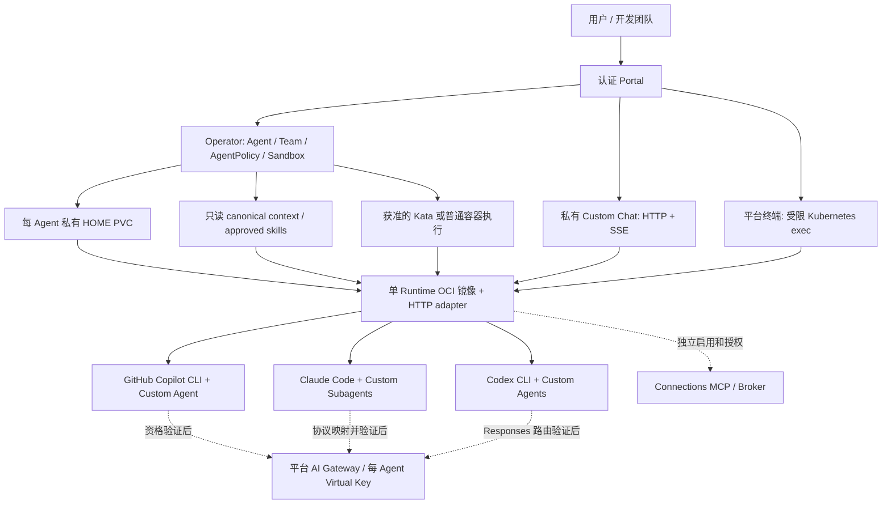

# 基于 CetiRun 的三种 Coding Agent Runtime 解决方案

## 结论与范围

建议采用 **一个治理平台、三个原生 Runtime、同一套 Custom Harness 外壳**：
CetiRun 负责身份、实例生命周期、HOME、执行隔离和模型/工具授权；
Copilot CLI、Claude Code、Codex CLI 保留各自的推理、工具、角色发现与委派机制。
不把三家 Agent 文件转换为一个通用 prompt runner，也不新增尚不存在的 CRD 类型。

历史方案以 CetiRun 源码快照
`97224f578d2c9c1dc50f2219c28691da2a861b9a` 为依据，核对日期 2026-11-08。
本示例现已迁入 CetiRun 的 `examples/coding-agents/`，平台源码位于同仓库
`app/`。历史快照与当前平台版本不应混为一谈，无需单独的参考仓库。
以下方案是**已存在平台契约上的产品设计**，不是“已部署三家完整 Runtime”的声明。

当前可运行交付是离线接口演示和显式启用的本地只读 CLI 适配。
生产模型路由、Connections MCP、镜像资格验证与平台实装列为后续门槛。

## 分层架构

图中三个 Runtime 是替代选项，**不是默认在同一 Pod 中同时运行**。
每个 Agent 使用单 Runtime 镜像；需要三家协作时创建三个独立 Agent，共属获准 Team，
但 HOME、Virtual Key 和会话不共享。普通容器共享节点内核，只有获准 Kata 路径
可主张 VM 级隔离，不能把“用了容器”当作充分安全结论。

| 层 | CetiRun 负责 | Runtime / 适配器负责 |
| --- | --- | --- |
| 身份 | Portal 用户和实例授权、Team/Policy 决策 | 不用本地 CLI 登录冒充平台身份 |
| 执行 | 镜像 digest 资格、Sandbox、资源、网络、生命周期 | 启动原生 CLI/SDK、执行它自己的工具 |
| 持久化 | HOME PVC、受控替换、停止旧 writer | workspace、原生 session 格式、显式 resume |
| 上下文 | 只读 `$HOME/.agents` canonical view | 显式桥接到三家的发现机制，不能覆盖用户文件 |
| 模型 | 受策略约束的 Gateway catalog / Virtual Key | 协议、模型别名、流式/tool call 与错误转换 |
| 工具 | Connections 的 owner binding、Broker/MCP 授权 | 原生 MCP client、轮换 proof 和 CA 的读取 |
| Chat | 私有路由、用户授权、浏览器历史 | `/healthz`、`/v1/models`、`/v1/chat/completions` |

## 三家 Agent 语义不能混用

| 维度 | GitHub Copilot | Claude Code | Codex |
| --- | --- | --- | --- |
| 实际托管对象 | 本方案是 Copilot CLI；不是搬迁 GitHub cloud agent 服务 | Claude Code CLI；不是外部 cloud session 产品 | Codex CLI；不是 Codex Web |
| 项目角色文件 | `.github/agents/*.agent.md` | `.claude/agents/*.md` | 当前官方文档的 `.codex/agents/*.toml` |
| 核心格式 | Markdown + YAML：description、tools、正文指令 | Markdown + YAML：name、description、tools、正文 | TOML：name、description、developer_instructions |
| 本例角色 | `cetirun-reviewer` | `cetirun-reviewer` | `cetirun-reviewer` |
| 主会话入口 | `copilot --agent ... -p ...` | `claude --agent ... -p` | `codex exec` |
| 委派 | Custom Agent 是角色定义；主 Agent 可委派 subagent | 原生 Agent 工具在会话内委派 | 主 Agent 使用原生线程/委派机制；需事件验收 |
| 工具限制 | tools 列表与会话 permission 是不同层 | tools、permissionMode、managed settings 组合 | 自定义角色继承父权限；部分 features 可关闭 |
| 主要区别 | CLI、IDE、cloud 的字段支持不相同 | Subagent、background session、agent team 不同 | `AGENTS.md` 是项目指令，不是角色注册 |

不硬编码模型版本，避免把服务商 model、CetiRun preferred model 和角色名字混为一谈。
当前 Codex 文档使用独立 TOML 角色文件；不能照搬早期仅在 `[agents.<role>]`
引用配置文件的示例。部署前固定获准 CLI 版本，针对该版本重验 schema。

本地例子把 Copilot/Claude 角色直接选为当前会话，Codex 则请求真实委派。
这验证配置入口的差异，并非三家拥有同构调度 API。完整生产示范可增加
planner → implementer → reviewer 流程，但委派应由每家 native runtime 管理，
不是平台再伪造一套内存里的 subagent。

## 平台契约与可复用能力

### 1. 使用 Custom，而非虚构内置类型

`HarnessSpec.Type` 只允许 `openclaw`、`hermes`、`custom`。
三个 Coding Runtime 都走 `spec.agent.type: custom`，设置获准 `image`、
现存非 root `username`；提供 Chat 时设置 `port: 8080`、`webUI: false`。
如果只要原生终端，使用 headless 模式，不声明应用 HTTP port。

CRD 不暴露任意 command/env/volume 覆盖。不可在 Agent YAML 中塞入
`command: copilot` 或 `ANTHROPIC_API_KEY`。镜像自有 ENTRYPOINT 决定运行方式。
不要把 `gatewayTokenSecretRef` 用于 Custom。

已实现的 Custom 路径包括 Sandbox 绑定与未选 Sandbox 的 opt-in binding provider。
生产建议选获准 Sandbox；不能在策略失败时切回另一条路径绕开授权。
管理员必须审批不可变 digest 和实际 numeric UID/GID，不能只审批 tag。

### 2. 上下文与原生角色分开治理

平台 canonical `AGENTS.md` / shared skills 是只读治理材料；
三家的角色文件是原生 Runtime 配置。它们不是同一个文件系统契约。

建议在经过审核的镜像中提供角色模板，在 HOME 初始化后的应用启动阶段校验版本，
显式合成原生指令/资源索引，并保持用户原文件。Canonical path、来源 digest、
共享 skill 版本与加载结果应可审计。不要用简单复制覆盖仓库的 `AGENTS.md` 或
`CLAUDE.md`，也不要宣称 `.agents` 自动被三家全部识别。

本例角色模板直接保存在合成 workspace，不实现平台 Context/Memory 桥接。
Sandbox-bound Memory 注入和 non-Sandbox Memory 行为在当前契约中不同，
不能从共享文档中的 Memory 默认值推断所有路径都可用。

### 3. 终端不是 Agent 镜像里的 ttyd

使用 CetiRun 独立 `cetirun-terminal`，经受限 exec 打开主容器的 shell。
Coding 镜像不要内置 kubeconfig、Kubernetes token 或另一套公开终端服务。
保持 HOME 为 `/home/vibe`、镜像用户 `1024:1024`，应用放 `/opt`；
满足共享 HOME 初始化和镜像工具契约后再审批。

持久 HOME 只保证文件存续；Pod 更换后应由用户显式恢复原生会话。
HTTP 原生 session 与 Portal Chat 浏览器历史不自动同步，也不能跨 Runtime 恢复。
删除 Agent 可能删除 namespace/PVC，不是重启手段。

## 模型与认证：必须单独资格验证

**GitHub Copilot 产品登录 ≠ GitHub Copilot 模型源授权 ≠ GitHub 仓库连接。**
Portal 的 Copilot sign-in / private model proxy 不会把 Copilot CLI 直接登录好。
Connections 的 GitHub owner binding 也不是模型授权或 CLI 订阅。

| Runtime | 生产候选接入 | 必须验证的缺口 |
| --- | --- | --- |
| Copilot CLI | 官方 BYOK：`COPILOT_PROVIDER_BASE_URL`、`COPILOT_PROVIDER_TYPE`、`COPILOT_PROVIDER_API_KEY` 和显式模型配置 | 模型/provider 接口、企业许可、登录边界、Agent/工具能力与 egress；不能拿 `OPENAI_BASE_URL` 当通用自动配置 |
| Claude Code | 使用获准 Claude 模型和 Anthropic-compatible Gateway endpoint；从平台 Virtual Key 做受控配置映射 | `ANTHROPIC_BASE_URL`、凭据/header、Messages 流式与 tool schema、模型名称映射；不能直接假设 Chat Completions endpoint 兼容 |
| Codex CLI | 通过官方 custom model provider / Responses 接口路由至平台 Gateway | `wire_api`、model provider、Virtual Key 引用、`/responses` stream/tool call、预算与错误归因 |

平台源码已有 LiteLLM/Responses 相关实现；**“代码里有 Responses”不等于当前
租户/model/CLI 组合已端到端资格验证**。同样，文档中部分章节保留旧 roadmap
表述，应以这次快照的代码、Custom 章节和部署版本组合验证，不能单摘一句“已支持”
或“未支持”作为所有路径结论。

Production 适配器必须 fail closed：Gateway 配置缺失、部分注入、模型未授权、
协议不兼容都报告明确阻塞，不静默转为个人 OAuth 或直接 provider API。
平台 Virtual Key 保持 Secret-backed，provider key 不进入 prompt/日志/浏览器。
请求重试必须知道结果；未知 outcome 不自动 replay。

Copilot 的映射方案可以明确为：由镜像自有入口在内存读取平台
`OPENAI_BASE_URL` / `OPENAI_API_KEY`，映射至
`COPILOT_PROVIDER_BASE_URL` / `COPILOT_PROVIDER_API_KEY`；
设置 `COPILOT_PROVIDER_TYPE=openai`，依据已验证的 Gateway 路由选择
`COPILOT_PROVIDER_WIRE_API=completions` 或 `responses`，并使用已授权模型。
这不是 CRD env 覆盖，也不是透传 GitHub 个人 token。BYOK 不要求 GitHub 登录；
它改变模型路由，不自动授予 GitHub 工具连接。三家入口都必须避免打印这些变量。
本例没有实现该生产入口，不能通过移除 native guard 来启用它。

本次不进行真实模型请求，不把私有仓库内容提交给外部研究/模型服务。
示例 native 模式仅用于用户获准的本地合成 fixture，检测到平台变量即拒绝。

## 工具连接与代码交付

生产可用 Connections MCP / Broker 提供有 owner binding 的 GitHub 等能力，
但 Custom 必须分别显式启用 Operator `connectionsMCP.runtimeTypes`、
Broker `toolService.runtimeTypes` 和 Portal `agentTools.runtimeTypes`。
还要让原生 MCP client 读取轮换的 workload proof / CA、验证 TLS、
遵守单次请求的结果未知边界。固定读取一次 token 后永久写进配置不合格。

本例没有接入 MCP、Agent Identity 或 Entra workload SDK，不能从三家的
原生 MCP 支持推出此平台已经集成。模型代理与工具代理保持分开。

建议产品工作流：用户选择 Runtime 与任务 → 平台授权 → 在私有 workspace
创建分支/worktree → Runtime 制定计划、实施和测试 → 原生 reviewer 审查
→ 产出 patch 和验证证据 → 人工批准后由受控交付通道提交 PR。

实现阶段与只读审查阶段使用不同角色/工具权限。不要在镜像里授予默认全权限，
不要多 Agent 共享一个可写 checkout。跨 Runtime 的协作结果采用 patch、测试记录
和明确 schema 的 handoff，不共享服务商 session ID 或认证文件。
PR 写权限与模型进程凭据应分离；CI 消费不可信 patch 的阶段不持有 provider key。

## 实施步骤与验收门槛

| 阶段 | 产物 | 完成条件 |
| --- | --- | --- |
| A：本次离线交付 | 中文方案、三家角色、统一 HTTP/SSE、mock 与本地 CLI 桥 | 单元测试和接口冒烟；native/provider 验收不冒充通过 |
| B：版本与镜像资格 | 三个单 Runtime 镜像、锁定 CLI/base digest、SBOM/许可证记录 | UID/GID、HOME 初始化、shell、read-only root、子进程回收、原生角色发现 |
| C：模型与工具资格 | 每 Runtime Gateway 协议适配、MCP 轮换凭证 client | 模型授权、预算归因、取消/超时/错误、无直接 provider fallback、无 credential 泄露 |
| D：平台集成 | 已批准 Team/Policy/Sandbox、Custom Agent、私有 Chat/终端 | 正确用户可访问，跨用户拒绝；NetworkPolicy/Cilium/mesh 与实际目标验证 |
| E：Coding 工作流 | planner/implementer/reviewer、patch 与 PR 审批通道 | 原生委派 evidence、最小权限、变更测试、人工交付批准 |

HTTP 生产版要实现运行中 SSE keepalive、native event 转换、可验证的取消传播，
输出/tool/token 预算、原生 failures 与 incomplete finishes 区分。不要先返回
`[DONE]` 再报告失败。开始后的 stream failure 与启动前 HTTP failure 要分开。

真实集群验收至少覆盖：实例创建/挂起/恢复、旧 writer 停止、HOME 保留、
UID/GID 与 CSI 权限、撤销模型/工具授权、流中断、子进程回收、版本升级、
私有路由拒绝跨用户访问、实际 egress 和 Gateway billing 归因。
`/healthz=200`、HTTP mock 成功或本地 render 都不替代这些验收。

部署模板仅展示现有字段，没有安装 Kubernetes、申请 Azure 资源或修改集群。
任何 Azure resource group、AKS 名称、registry、tenant、Team、Sandbox 和镜像
digest 都由操作者提供，不绑定私人部署名。

## 来源证据

路径相对于 CetiRun 仓库根目录，可在记录的 commit 上复核：

| 证据 | 支持结论 |
| --- | --- |
| `README.md:8-12`、`README.md:44-56` | 托管平台定位与组件 |
| `app/cetirun-operator/api/v1alpha1/harness_types.go:11-18,29-38,60-84` | 三种 type、username/port/WebUI schema |
| `app/cetirun-operator/api/v1alpha1/agent_types.go:40-96` | Agent、Team、Sandbox、modelAccess、Custom Secret 限制 |
| `site/content/en/docs/reference/agent-harness.md:90-156` | Custom approval、Gateway 环境、模型源显式选择、隔离边界 |
| `site/content/en/docs/reference/agent-harness.md:169-202` | canonical context、Connections opt-in 与 rotating proof |
| `site/content/en/docs/reference/agent-harness.md:387-405` | HOME 初始化与旧文件保留 |
| `site/content/en/docs/reference/agent-harness.md:740-771` | Chat 三路由、Portal history、私有路由 |
| `examples/pi-agent/README.md:140-160,200-241` | 既有 Custom 示例集成方向与 manifest 结构 |
| `app/cetirun-ai-gateway/cetirun_ai_gateway/guard.py:257,310` | Gateway 中 Responses 相关实现，不证明三家 Runtime 资格 |

### 官方来源

仅使用官方公开文档核对格式与语义，未发送私有代码给这些站点：

| 官方文档 | 核对内容 |
| --- | --- |
| [GitHub Custom agents](https://docs.github.com/en/copilot/concepts/customizations/custom-agents) | 定义与 subagent 区别、使用环境 |
| [GitHub Custom agents configuration](https://docs.github.com/en/copilot/reference/custom-agents-configuration) | frontmatter、工具 alias、跨环境字段差异 |
| [Copilot CLI custom agents](https://docs.github.com/en/copilot/how-tos/copilot-cli/customize-copilot/create-custom-agents-for-cli) | 项目角色路径与 CLI 入口 |
| `copilot --help`、`copilot help providers` 与本机官方 CLI reference | `--agent`、`-p`、permissions、非交互选项与 BYOK 协议/环境变量 |
| [Claude Code Subagents](https://code.claude.com/docs/en/sub-agents) | `.claude/agents`、角色、权限、原生委派 |
| [Claude Code CLI reference](https://code.claude.com/docs/en/cli-reference) | `--agent`、`-p`、JSON、MCP 和工具限制 |
| [Claude Code LLM Gateway](https://code.claude.com/docs/en/llm-gateway) | 支持的协议、Claude 模型与认证边界 |
| [OpenAI Codex repo](https://github.com/openai/codex) | CLI、IDE、App、Web 的产品区别 |
| [Codex Subagents](https://developers.openai.com/codex/subagents) | 当前 TOML 角色、父权限继承、thread 管理 |
| [Codex Non-interactive](https://developers.openai.com/codex/noninteractive) | exec、JSONL、read-only、非 Git override、无自动 replay |
| [Codex Config reference](https://developers.openai.com/codex/config-reference) | provider/config 的核对入口，部署时按锁定版本再验 |

OpenAI 文档入口本次重定向至 `learn.chatgpt.com`。在线文档随版本变化，
不能以核对日期替代部署时版本矩阵；所有未经本机真实 CLI 或集群验证的能力
均保持待验收。
